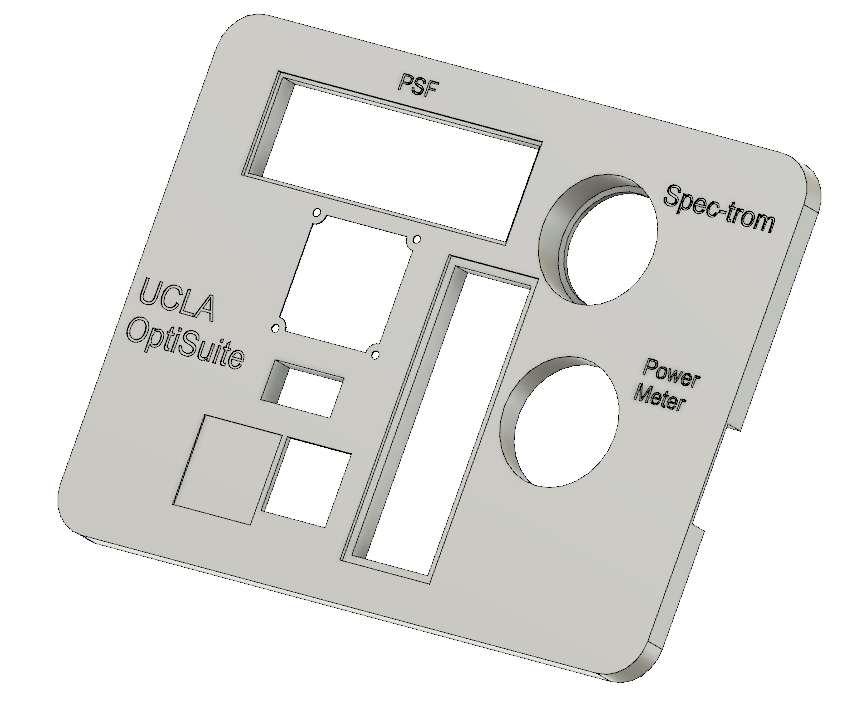

# UCLA OptiSuite

**An open-source platform for characterizing optical microscopes.**

OptiSuite measures how well a microscope performs (resolution, point-spread function, spectrum and
light power) using one 3D-printed characterization plate and software that moves the plate under
the microscope, takes the images and analyzes them. Instead of swapping test slides and instruments
by hand, every test target sits in a fixed position on the plate, so a whole characterization can
run as one routine.

<p align="center">
  
</p>

## The characterization plate

The plate holds every test target and sensor in a known position, so the motorized stage can move
from one test to the next.

<p align="center">
  
</p>

| Station | What it measures |
|---|---|
| **Resolution target** (USAF 1951) | Finest resolved line pair and the contrast at each spatial frequency |
| **PSF slide** | Point-spread function: the image of a sub-resolution point, showing blur and aberrations |
| **Spectrometer** | Spectrum of the illumination or the projected light |
| **Power meter** | Light power at the sample plane |

The plate designs are in [`Images/`](Images). Several holder versions are included (`SlidesHolder v24`–`v26`).

## How it works

```
 PyQt control app  ──ZeroMQ──▶  SC3U stage controller  ──serial──▶  motorized XYZ stage
 (cameras, routines,                (C#, Windows)
  autofocus, analysis)
        │
        ▼
 camera images  ──▶  analysis (USAF resolution, focus)  ──▶  results, plots, logs
```

1. **Camera and stage control.** A PyQt desktop app runs one or more DaHeng cameras (live view,
   exposure, gain, screenshots and recording). It sends move commands over ZeroMQ to the stage
   controller.
   **Micro-Manager:** the app can also use [Micro-Manager](https://micro-manager.org) through
   [Pycro-Manager](https://pycro-manager.readthedocs.io) as its camera and stage backend
   (Backend = Pycro-Manager), so OptiSuite works with hardware Micro-Manager already supports.
   Micro-Manager can run with its GUI or headless (no GUI). This backend is currently on the
   `usaf_target` branch.
2. **Stage routines.** A routine is a list of plate positions. The app moves to each station in turn,
   with soft travel limits, and can pause and resume between steps.
3. **Autofocus.** Focus is found by scoring image sharpness (Laplacian variance, Tenengrad or
   Brenner) through a Z sweep.
4. **Analysis.** Images are analyzed automatically. For the resolution target, the
   [USAF matched-filter reader](USAF_matched_filter_reader) identifies every group and element and
   reports the finest one that still reaches the required contrast (20 % by default).

## Repository layout

| Folder | Contents |
|---|---|
| [`USAF_matched_filter_reader/`](USAF_matched_filter_reader) | Reads microscope images of a USAF 1951 target: element identification, contrast per element, resolution limit and a contrast-curve fit, with a synthetic target generator, validation and a benchmark. See its [README](USAF_matched_filter_reader/README.md). |
| [`SC3U_stage_control/`](SC3U_stage_control) | C# Windows app for the SC3U stage controller. Receives move commands over ZeroMQ and publishes stage events. |
| [`Python versions/OCS_ocurrent_workspace_052825/`](Python%20versions/OCS_ocurrent_workspace_052825) | Current Python workspace: camera and stage control app, stage routines, autofocus and ZeroMQ workers. |
| [`Python versions/SC3U_Headless_C++_Library_093025/`](Python%20versions/SC3U_Headless_C++_Library_093025) | Headless C++ stage-control library (no GUI) with build instructions. |
| [`Images/`](Images) | Plate designs and photos. |
| `Python versions/` (other folders) | Older and obsolete versions, kept for reference. |

## Hardware

- Motorized XYZ stage with an SC3U controller
- DaHeng industrial cameras (`gxipy` SDK)
- Or any camera and stage that Micro-Manager supports, through the Pycro-Manager backend
- 3D-printed characterization plate with a USAF 1951 target, a PSF slide, a spectrometer and a power meter

## Status

OptiSuite is under active development at UCLA. The stage controller app runs on Windows. The
analysis tools are plain Python and run on any platform.
